# Misión 0 · Monta tu laboratorio de hacking ético

**Nombre:** Fernando Romero Gómez

**Curso de Especialización en Ciberseguridad · Unidad didáctica 1**

---

## 1. Evidencias de los hitos

### H1 · Requisitos

Mi equipo tiene la virtualización por hardware habilitada (Administrador de tareas → Rendimiento → CPU → Virtualización: Habilitado).

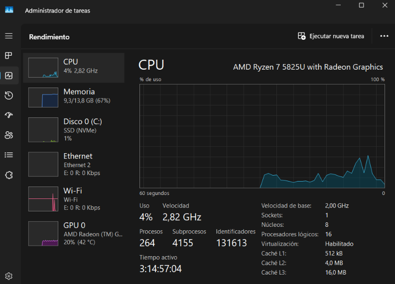

### H2 · Instalar VirtualBox e importar Kali

Hash SHA256 de la imagen de Kali (`kali-linux-2026.3-virtualbox-amd64.7z`) calculado en PowerShell con `Get-FileHash` y comparado con el publicado en la web oficial de Kali, coinciden:

`84863C4FA46B2F1B29B152348583C6FB20F68F91971617C0D684E0EB163AAB6D`

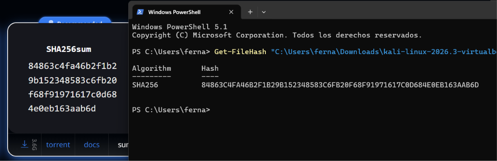

Terminal de Kali tras cambiar la contraseña con `passwd` (`password updated successfully`) y actualizar el sistema con `sudo apt update && sudo apt full-upgrade`:

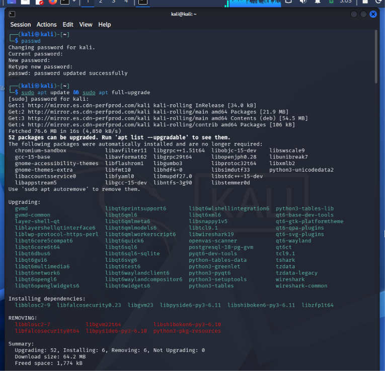

### H3 · Red aislada `labnet`

Comando para crear el servidor DHCP de `labnet`:

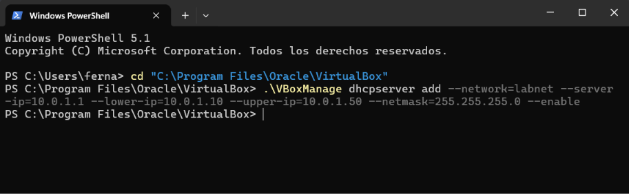

Comprobación con `VBoxManage list dhcpservers`: el servidor de `labnet` está habilitado, con IP `10.0.1.1`, rango `10.0.1.10` a `10.0.1.50` y máscara `255.255.255.0`:

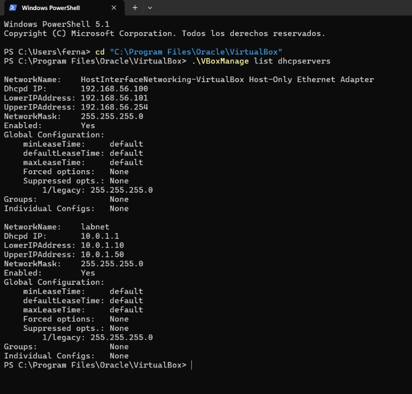

Salida de `ip -br addr` en Kali: `eth0` con `10.0.2.15` (NAT) y `eth1` con `10.0.1.11` (`labnet`):

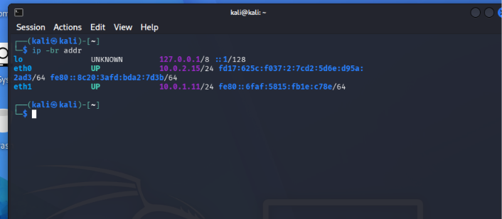

### H4 · Máquina víctima DC-1

Configuración de red de DC-1: Adaptador 1 habilitado, conectado a Red interna con el nombre **`labnet`**, y sin ningún otro adaptador habilitado:

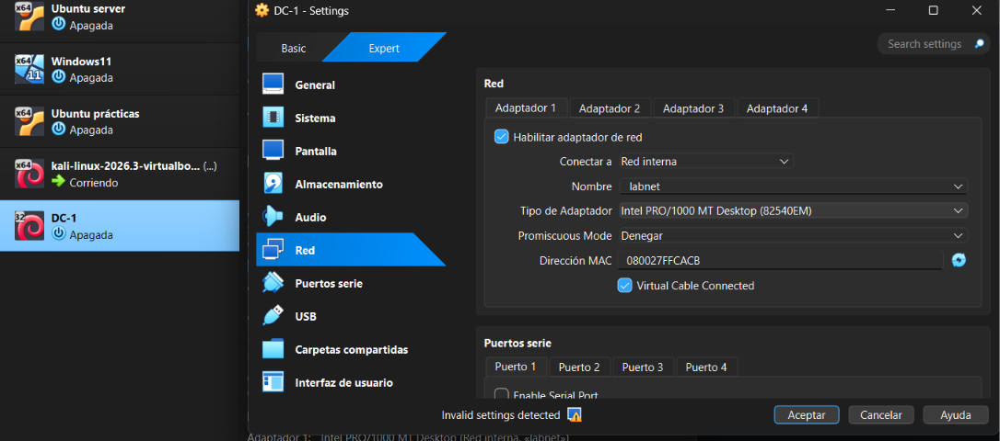

DC-1 arrancada, esperando login (no necesario):

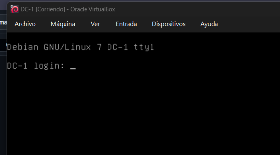

### H5 · Conectividad

Desde Kali, `netdiscover` localiza DC-1 en `10.0.1.12` y el `ping` recibe respuesta (3 paquetes enviados, 3 recibidos, 0 % de pérdida):

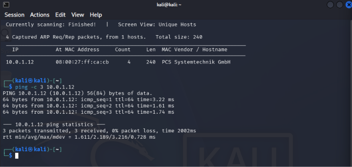

### H6 · Instantáneas

Instantánea `kali-limpia` en Kali:

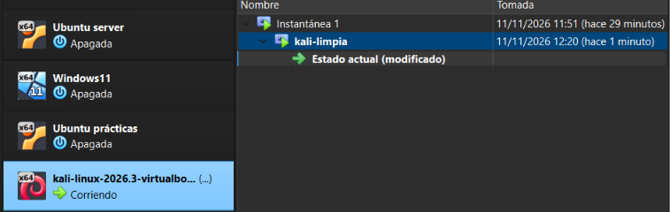

Instantánea `dc1-original` en DC-1:

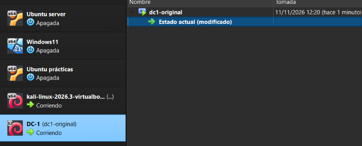

---

## 2. Ficha

### ¿Por qué DC-1 no debe tener adaptador NAT ni puente?

DC-1 es una máquina vulnerable a propósito. Si tuviera un adaptador NAT tendría salida a Internet, y si tuviera uno en modo puente estaría directamente en mi red real, con una IP de esa red. En ambos casos otros dispositivos o personas podrían alcanzarla, atacarla o incluso usarla como punto de entrada a mi red. Por eso solo tiene un adaptador en la red interna `labnet`: así únicamente puede comunicarse con las máquinas del laboratorio (Kali) y nunca sale de él.

### ¿Para qué sirve el servidor DHCP que creaste en H3?

Una red interna de VirtualBox no reparte direcciones IP por sí sola. El servidor DHCP que creé para `labnet` asigna automáticamente una IP a cada máquina que se conecta a esa red, dentro del rango `10.0.1.10` a `10.0.1.50`. Gracias a él Kali obtuvo `10.0.1.11` en `eth1` y DC-1 obtuvo `10.0.1.12`, sin tener que configurarlas a mano.

### ¿Qué hacen `netdiscover` y `ping`, y qué información te dio cada uno?

- **`netdiscover`** (`sudo netdiscover -i eth1 -r 10.0.1.0/24`) descubre qué equipos hay en la red mediante peticiones ARP. `-i eth1` indica la interfaz por la que escanear (la de `labnet`) y `-r 10.0.1.0/24` el rango de direcciones a explorar. Me dio la IP de DC-1 (`10.0.1.12`) y su dirección MAC (`08:00:27:ff:ca:cb`), cuyo prefijo corresponde a una tarjeta de red virtual de VirtualBox.
- **`ping`** (`ping -c 3 10.0.1.12`) envía 3 paquetes ICMP a una IP concreta y espera respuesta. No sirve para descubrir equipos, sino para comprobar que uno concreto responde. Me confirmó que hay conectividad entre Kali y DC-1: 3 paquetes enviados, 3 recibidos, 0 % de pérdida, con un tiempo medio de unos 2 ms.

---

## 3. Bitácora de IA

**Error que me apareció.** En mi primera máquina Kali cambié la contraseña por defecto con `passwd`. Al volver a iniciar sesión no me dejaba entrar con ninguna de las contraseñas que probé. Además, el teclado del login estaba en inglés (`en`) y lo cambié a español (`es`), y seguía sin entrar. No podía ver lo que escribía, así que no sabía si el fallo era de la contraseña o del teclado.

**Qué le pregunté a la IA.** Le expliqué que había cambiado la contraseña, que no podía entrar y que había probado con el teclado en `en` y en `es`. Le pregunté qué podía hacer.

**Cómo lo resolví.**

1. La IA me explicó que lo más probable era la distribución del teclado, porque el login usa teclado inglés y los símbolos cambian de tecla. Me sugirió escribir la contraseña en el campo de usuario, donde sí se ve, para comprobarlo.
2. Como no funcionó, me indicó resetear la contraseña desde el menú GRUB entrando en recovery mode.
3. **Aquí la IA se equivocó.** Al elegir el modo recovery apareció el mensaje de que la cuenta root estaba bloqueada, así que no se podía abrir una consola de root. En Kali la cuenta root está bloqueada por defecto, y la IA no lo tuvo en cuenta. Después me propuso otro método (editar la línea de arranque en GRUB añadiendo `init=/bin/bash`).
4. Antes de aplicarlo, decidí descartar esa máquina y montar una nueva. Primero hubo un problema: al abrir el archivo `.vbox` de la imagen se abría la máquina vieja, porque seguía registrada y en ejecución. La IA me indicó apagarla, eliminarla de VirtualBox, volver a descomprimir la imagen en una carpeta nueva e importarla de nuevo.
5. Con la máquina nueva configuré el Adaptador 1 en NAT y el Adaptador 2 en red interna `labnet`, continué con la misión y cambié la contraseña con `passwd` sin problemas (captura en H2).

**Lección aprendida.** Para evitar el mismo problema: hacer una instantánea antes de cambiar la contraseña, usar una contraseña solo con letras minúsculas y números (que están en la misma tecla en teclado español e inglés) y comprobarla con `su - kali` antes de cerrar la sesión.
